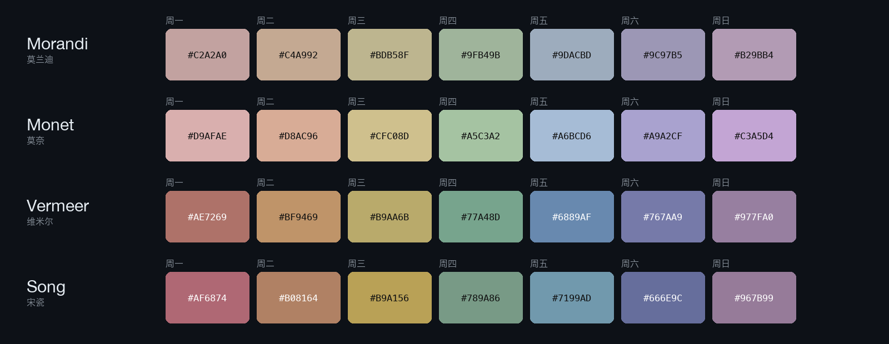
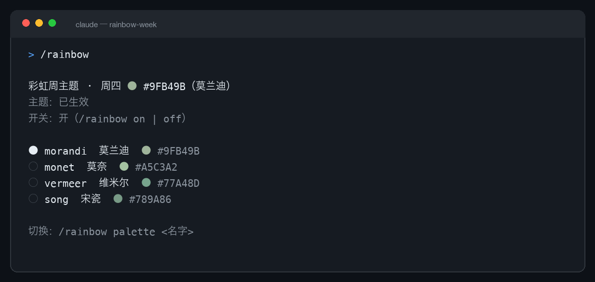

<div align="center">

# Rainbow Week

**Claude's accent, one muted colour a day.**

[](LICENSE)
[](.claude-plugin/plugin.json)
[](https://code.claude.com/docs)
[](https://claudemods.dev/zh-cn/builds/rainbow-week-b3ec46)



</div>

Rainbow Week repaints Claude Code's accent — the `claude` token, the input border, the mascot — in one low-saturation colour per weekday, walking the rainbow in order: **red → orange → yellow → green → blue → indigo → violet**.

Four palettes ship with it, all muted: **Morandi** (default), **Monet**, **Vermeer**, and **Song porcelain**.

## Install

```
/plugin marketplace add IVLIU/rainbow-week
/plugin install rainbow-week@rainbow-week
```

Then restart Claude Code. If the colour has not changed on the first run, open `/theme` once and pick **Rainbow Week** — the mod keeps it from there.

## What you get

<div align="center">

</div>

- The accent, the prompt border and the `clawd` mascot follow the day's colour; shimmer partners are derived automatically.
- Switches at local midnight, so a long-running session turns over by itself.
- `/rainbow off` puts back the theme you had before, and remembers it.

## Palettes

Monday → Sunday. Every palette walks the same hue order in its own key.

| | Mon | Tue | Wed | Thu | Fri | Sat | Sun |
|---|---|---|---|---|---|---|---|
| **Morandi** (default) | `#C2A2A0` dusty rose | `#C4A992` clay | `#BDB58F` wheat | `#9FB49B` sage | `#9DACBD` mist blue | `#9C97B5` dusty indigo | `#B29BB4` grey violet |
| **Monet** | `#D9AFAE` water-lily | `#D8AC96` sunrise | `#CFC08D` hay | `#A5C3A2` iris | `#A6BCD6` Giverny blue | `#A9A2CF` dusk | `#C3A5D4` wisteria |
| **Vermeer** | `#AE7269` ochre red | `#BF9469` ochre | `#B9AA6B` olive gold | `#77A48D` celadon | `#6889AF` Delft blue | `#767AA9` blue violet | `#977FA0` pearl violet |
| **Song porcelain** | `#AF6874` rouge | `#B08164` ochre | `#B9A156` rattan yellow | `#789A86` bamboo | `#7199AD` sky blue | `#666E9C` indigo | `#967B99` lotus violet |

Saturation stays between 12% and 46%; Morandi is the quietest.

## Commands

| Command | What it does |
|---|---|
| `/rainbow` | Today's colour, active palette, on/off state |
| `/rainbow palette` | List the four palettes, each with a true-colour dot |
| `/rainbow palette morandi\|monet\|vermeer\|song` | Switch palette, applied immediately |
| `/rainbow on` / `/rainbow off` | Toggle the rotation and restore the previous theme |

## How it works

Claude Code's `theme` setting only accepts built-in presets, so a plugin cannot switch a custom theme through `config.set`. Rainbow Week instead:

1. writes `~/.claude/themes/rainbow-week.json` — a custom theme whose `overrides` hold today's colour, inheriting `base` from whatever preset you had (light stays light, daltonized stays daltonized);
2. points `theme` in `~/.claude/settings.json` at `custom:rainbow-week`;
3. re-applies just past local midnight. The theme directory is watched, so rewriting the file repaints without a restart.

## Notes

- Writes only `~/.claude/themes/rainbow-week.json` and the `theme` key of `~/.claude/settings.json`; `/rainbow off` restores the previous value.
- Requires a Claude Code build with custom themes (2.1.118+).
- Colour dots in command output use 24-bit ANSI escapes; terminals without true colour show them as plain white.
- MIT licensed.

---

<div align="center"><sub>Not affiliated with Anthropic. Claude and Claude Code are trademarks of Anthropic, PBC.</sub></div>

<details>
<summary><b>中文</b></summary>

按彩虹顺序给 Claude 主色每周换一种低饱和颜色：周一红 → 周日紫。内置四套配色——莫兰迪（默认）、莫奈、维米尔、宋瓷，`/rainbow palette` 随时切换，`/rainbow off` 恢复原主题。

安装：

```
/plugin marketplace add IVLIU/rainbow-week
/plugin install rainbow-week@rainbow-week
```

装完重启 Claude Code；首次如果颜色没变，跑一次 `/theme` 选 **Rainbow Week**。本地午夜自动换色，跨天不用重启。

</details>
